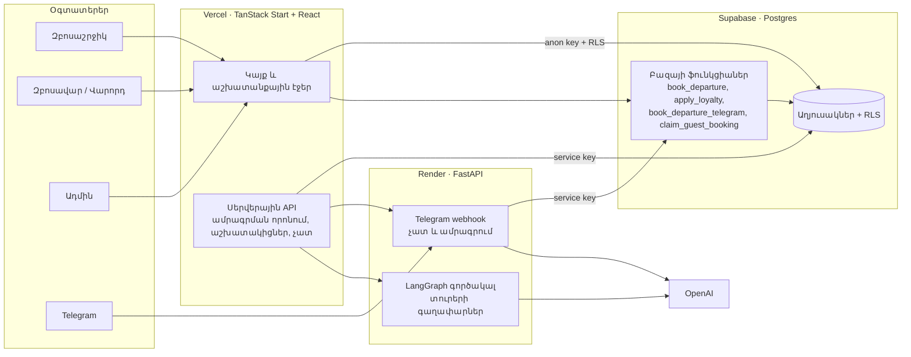

# Արի Գնանք

Մեկօրյա տուրեր Արմավիրից. կայք, Telegram բոտ և աշխատանքային էջեր զբոսավարի, վարորդի ու ադմինի համար։

- Կայք՝ https://perfect-picture-pal-beige.vercel.app
- Backend (AI և Telegram)՝ https://perfect-picture-pal.onrender.com
- Ավարտական աշխատանք «Վայբ կոդինգ և բիզնես ավտոմատացում» դասընթացի համար

## Խնդիրը

Փոքր տուրօպերատորը ամրագրումներ էր ընդունում հեռախոսով և մեսենջերներով։ Տեղերը հաշվում էր ձեռքով, ուղևորների ցուցակը ուղարկում զբոսավարին նամակով, իսկ վերադարձող հաճախորդներին ոչինչ չէր առաջարկում։ Սխալները (կրկնակի ամրագրում, լրացած ավտոբուս, կորած ցուցակ) արժենում էին փող և վստահություն։

## Լուծումը

Մեկ համակարգ, որտեղ յուրաքանչյուր դեր տեսնում է միայն իր գործը, իսկ կրկնվող քայլերը կատարվում են ինքնաշխատ։

| Ով         | Ինչ է անում                                                                                                       | Որտեղ                      |
| ---------- | ----------------------------------------------------------------------------------------------------------------- | -------------------------- |
| Զբոսաշրջիկ | Ընտրում է տուր և օր, ամրագրում, ստանում QR տոմս, կուտակում և ծախսում միավորներ                                    | Կայք, AI չատ, Telegram բոտ |
| Զբոսավար   | Տեսնում է իր մեկնումները և ուղևորների ցուցակը, սկանավորում QR-ը նստեցման ժամանակ                                  | `/guide`                   |
| Վարորդ     | Տեսնում է իր երթուղիները և ուղևորների քանակը                                                                      | `/driver`                  |
| Ադմին      | Կառավարում է տուրերը, օրերը, աշխատակիցներին, տեսնում ամրագրումներն ու եկամուտը, ստանում AI-ի առաջարկած նոր տուրեր | `/admin`                   |

## Ինչն է ավտոմատացված

1. **Ամրագրում երեք ճանապարհով.** կայքի ձևով, AI չատում և Telegram բոտում։ Ամեն դեպքում միևնույն բազայի ֆունկցիան է ամրագրում տեղը, այնպես որ կանոնները մեկն են։
2. **Տեղերի հաշվարկ.** ազատ տեղերը նվազում են ամրագրման պահին, նստատեղերի համարները տրվում են հերթով, իսկ լրացած մեկնումն այլևս չի առաջարկվում։
3. **Կրկնակի ամրագրման պաշտպանություն.** նույն հաստատումը երկրորդ անգամ նոր ամրագրում չի ստեղծում, իսկ փոխված գինը կամ օրը չեն ընդունվում առանց նոր հաստատման։
4. **Թվային տոմս.** QR կոդ, որը զբոսավարը սկանավորում է, և ներկայությունը նշվում է ինքնաշխատ։
5. **Հավատարմություն.** հետվճար վճարված գումարից, միավորների ծախսում հաջորդ ամրագրման ժամանակ (1 միավոր = 1 ֏)։ Միավորները կապված են հաշվին, ոչ թե հեռախոսահամարին։
6. **Առանց հաշվի արված ամրագրումները** ինքնաշխատ կցվում են հաշվին նույն սարքից մուտք գործելիս, կամ ձեռքով՝ տոմսի կոդով և հեռախոսով։
7. **Աշխատակիցների տվյալների բացահայտում ըստ ժամանակի.** զբոսավարի և վարորդի անունը ուղևորը տեսնում է մեկնումից մեկ օր առաջ։
8. **AI տուրերի գաղափարներ.** LangGraph գործակալը հետազոտում է վայրերը, հաշվում երթուղու կիլոմետրերը և առաջարկում գին ադմինին։
9. **AI չատ կայքում և Telegram-ում.** պատասխանում է միայն իրական տուրերի և մեկնումների տվյալներով, հիշում է զրույցը։

## Ճարտարապետություն



**Հիմնական որոշումներ**

- **Բիզնես կանոնները բազայում են.** ամրագրումը, միավորները և կցումը կատարում են Postgres ֆունկցիաները մեկ գործարքով։ Այսպես կայքը, չատը և բոտը չեն կարող տարբեր կերպ ամրագրել, և երկու մարդ չեն կարող վերցնել նույն վերջին տեղը։
- **Row Level Security.** զբոսաշրջիկը տեսնում է միայն իր ամրագրումները, զբոսավարը՝ միայն իրեն նշանակված մեկնումները։ Ծառայողական բանալին կա միայն սերվերներում։
- **Գաղտնի ոչինչ բրաուզերում.** բրաուզերը ունի միայն հանրային բանալին։ Մնացածը Vercel-ի և Render-ի կարգավորումներում է։

## Տեխնոլոգիաներ

| Մաս          | Ինչով                                                     |
| ------------ | --------------------------------------------------------- |
| Կայք         | TanStack Start, React 19, TypeScript, Tailwind, shadcn/ui |
| Բազա և մուտք | Supabase (Postgres, Auth, Storage, RLS)                   |
| Backend      | Python 3.11, FastAPI, LangGraph, OpenAI                   |
| Բոտ          | Telegram Bot API (webhook)                                |
| Տեղադրում    | Vercel (կայք), Render (backend)                           |
| Ստուգումներ  | bun test, pytest, ruff, ESLint, GitHub Actions            |

## Կառուցվածք

```
src/routes/          էջեր և API (/admin, /guide, /driver, /profile, /tours/$id, /api/...)
src/components/      React բաղադրիչներ
src/lib/             բիզնես տրամաբանություն և Supabase կանչեր
backend/             FastAPI: Telegram բոտ, AI չատ, տուրերի գաղափարների գործակալ
backend/agent/       LangGraph գործակալ, երթուղու հաշվարկ, գնագոյացում
supabase/migrations/ բազայի սխեման և ֆունկցիաները, ըստ հերթականության
supabase/tests/      բազայի ավտոմատ թեստեր
scripts/             օգնող սկրիպտներ (բազայի ստուգում, ադմինի գաղտնաբառ)
```

## Ստուգումներ

Յուրաքանչյուր փոփոխության ժամանակ GitHub Actions-ը աշխատեցնում է երեք ստուգում ([.github/workflows/ci.yml](.github/workflows/ci.yml))․

| Ստուգում | Ինչ է անում                                                                                                                                                     |
| -------- | --------------------------------------------------------------------------------------------------------------------------------------------------------------- |
| Website  | TypeScript տիպեր, ESLint, 114 թեստ, build                                                                                                                       |
| Backend  | ruff, 124 թեստ                                                                                                                                                  |
| Database | Բոլոր migrations-ը կիրառում է դատարկ Postgres-ի վրա, վերջիններս՝ երկու անգամ, և աշխատեցնում բազայի թեստերը (միավորներ, Telegram ամրագրում, ամրագրումների կցում) |

Տեղական աշխատեցում․

```sh
npm ci
npm run typecheck && npm run lint && npm run test && npm run build

cd backend
pip install -r requirements.txt pytest ruff
ruff check . && python -m pytest -q

# Postgres 16 (PGHOST, PGPORT, PGUSER, PGPASSWORD)
./scripts/check-database.sh
```

## Կարգավորումների ինքնաստուգում

Live սերվերները ցույց են տալիս, թե արդյոք բոլոր կարգավորումները տեղում են։ Պատասխանը միայն այո/ոչ է, բանալիներ չի բացահայտում։

- Կայք՝ `GET /api/health/setup`
- Backend՝ `GET /health/setup`։ Ստուգում է նաև, որ բազայում կան այս տարբերակին պետք եղող աղյուսակները և ֆունկցիաները։ Այդպես բաց թողնված migration-ը երևում է անմիջապես։

## Տեղադրում

1. **Supabase.** SQL Editor-ում գործարկեք `supabase/migrations/` ֆայլերը ըստ անվան հերթականության։
2. **Vercel (կայք).** `VITE_SUPABASE_URL`, `VITE_SUPABASE_ANON_KEY`, `SUPABASE_SERVICE_ROLE_KEY`, `PYTHON_BACKEND_URL`, `IDEAS_API_SECRET`, `CHAT_INTENT_API_SECRET`։
3. **Render (backend, [render.yaml](render.yaml)).** `OPENAI_API_KEY`, `SUPABASE_URL`, `SUPABASE_SERVICE_ROLE_KEY`, `TELEGRAM_BOT_TOKEN`, `TELEGRAM_WEBHOOK_SECRET`, `PUBLIC_SITE_URL`, `IDEAS_API_SECRET`, `CHAT_INTENT_API_SECRET`, `CORS_ORIGINS`։
4. Բացեք `/api/health/setup` և `/health/setup`։ Երկուսն էլ պետք է ցույց տան `"ok": true`։

Բոլոր կարգավորումների նկարագրությունը՝ [.env.example](.env.example)։

## Սահմանափակումներ և հաջորդ քայլեր

- **Վճարումներ.** Idram, Telcell և ArCa ինտեգրացիաները փորձնական ռեժիմում են (`VITE_PAYMENT_MODE`)։ Իրական վճարման համար պետք է պայմանագիր վճարային համակարգի հետ։ Telegram-ի ամրագրումները պահվում են «Սպասում» վճարման կարգավիճակով։
- **SMS և WhatsApp.** տոմսի ուղարկումը պատրաստ է, բայց առանց պրովայդերի բանալիների աշխատում է թեստային ռեժիմում, և տոմսն այդ մասին ազնվորեն նշում է։
- **Հեռախոսի հաստատում SMS կոդով** կավելանա SMS պրովայդերի հետ միասին։ Մինչ այդ ամրագրումները հաշվին կցվում են միայն ապացույցով (նույն սարք կամ տոմսի կոդ + հեռախոս)։

## Ինչպես է ստեղծվել

Նախագիծը ստեղծվել է վայբ կոդինգով։ Բիզնես կանոնները, առաջնահերթությունները և ընդունման ստուգումները սահմանել է հեղինակը, իսկ կոդը, թեստերը և անվտանգության վերանայումները գրվել են AI գործակալի հետ միասին։ Յուրաքանչյուր փոփոխություն անցել է pull request-ով և թեստերով։
